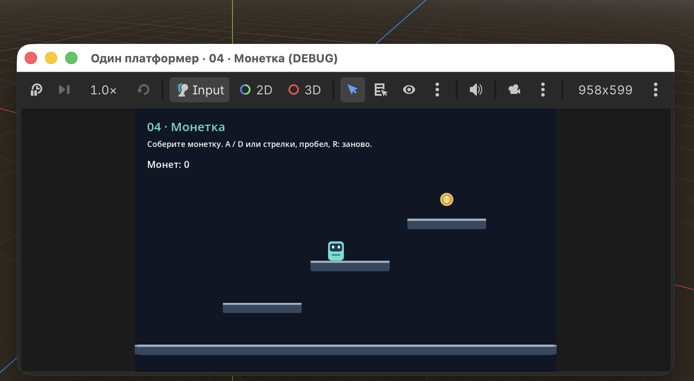
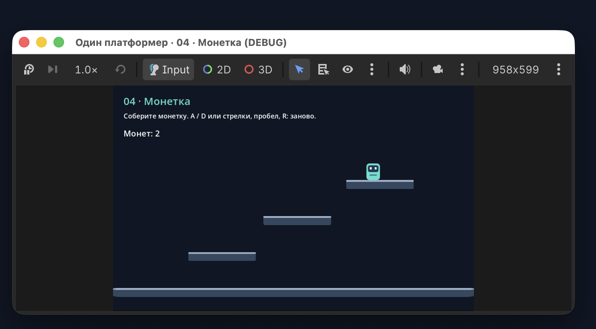

# Лабораторная работа 2

Задание: выполнить четыре опыта с платформером и объяснить границу между игрой и движком.

## Опыты

| Изменение      | Мой прогноз                                       | Что изменил                                | Что наблюдал                                                 | Правило игры или возможность движка?                          |
| -------------- | ------------------------------------------------- | ------------------------------------------ | ------------------------------------------------------------ | ------------------------------------------------------------- |
| Высота прыжка  | Прыжок станет выше                                | Jump Velocity: -560 -> -720                | Прыжок стал выше                                             | Параметр правила игры                                         |
| Клавиша прыжка | J заменит пробел без правки скрипта               | В Input Map заменил Space на J             | Прыжок работает на J, на пробел не работает. Скрипт не менял | Настройка ввода движка                                        |
| Коллайдер      | Герой останется видимым, но провалится сквозь пол | Включил Disabled у CollisionShape2D        | Изображение осталось, герой проваливается сквозь пол         | Настройка физики движка                                       |
| Вторая монетка | После сбора двух монеток счёт станет 2            | Добавил второй экземпляр Coin в (490, 304) | После сбора двух монеток счёт равен 2                        | Состав уровня игры; создание экземпляров предоставляет движок |

## Снимки экрана

Исходная игра, счёт 0.

После сбора двух монеток, счёт 2.

## Ответы

**Что делает** `player.gd`**, а что выполняет** `move_and_slide()`**?**

`player.gd` задаёт скорость, гравитацию и условие прыжка. `move_and_slide()` перемещает тело с учётом столкновений.

**Где хранится счёт? Знает ли** `coin.gd` **путь к надписи со счётом?**

Счёт хранится в `world.gd`. Монетка отправляет сигнал `collected` и не обращается к надписи со счётом.

**Какие файлы переношу во вторую игру без изменений? Какие правила пересматриваю?**

Сцену платформы переношу без изменений. Для игрока пересматриваю управление и прыжок, для монетки - награду, для мира - состав уровня и подсчёт очков.
